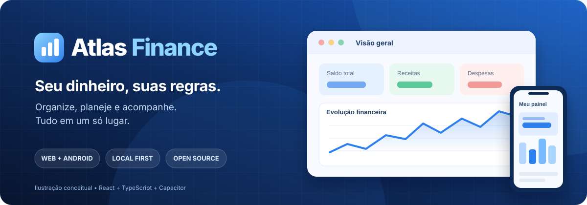

<p align="center">
  
</p>

<p align="center">
  <strong>Seu dinheiro, suas regras.</strong><br/>
  Controle financeiro pessoal, feito para Web e Android, com foco em privacidade e organização.
</p>

<p align="center">
  <a href="README.en.md">English</a> ·
  <a href="#-começando">Instalação</a> ·
  <a href="CONTRIBUTING.md">Contribuir</a> ·
  <a href="SECURITY.md">Segurança</a> ·
  <a href="LICENSE">Licença</a>
</p>

<p align="center">
  <a href="https://github.com/Bakeend/financas/actions/workflows/stable-build.yml"></a>
  
  
  
</p>

> **Status:** projeto independente em evolução. A documentação descreve o código da branch `master`, não uma versão de produção auditada. Não há serviço hospedado oficialmente indicado neste repositório.

## ✨ O que é o Atlas?

O **Atlas Finance** é um aplicativo de finanças pessoais para registrar movimentações, organizar pagamentos e visualizar como receitas e despesas afetam o orçamento. A experiência é pensada para telas pequenas, com opção Web/PWA e empacotamento Android via Capacitor.

### Funcionalidades disponíveis

| Área | O que oferece |
| --- | --- |
| **Painel** | Saldos, receitas, despesas, gráficos e visão geral |
| **Movimentações** | Entradas, saídas, transferências e categorias |
| **Contas e carteiras** | Múltiplas contas e saldos |
| **Organizar** | Planejamento de distribuição do dinheiro recebido |
| **Cartões de crédito** | Cartões, faturas, compras e parcelas |
| **Orçamentos e metas** | Limites por categoria e objetivos financeiros |
| **Recorrências** | Contas e receitas periódicas |
| **Previsão** | Simulação de saldo futuro e indicação de risco |
| **Importação** | Arquivos CSV e OFX, com revisão e detecção de duplicados |
| **Personalização** | Temas, atalhos, widgets e notificações |
| **Backup** | Exportação e restauração manual em JSON |

> A ilustração do banner é conceitual. Consulte o código para verificar a interface e os comportamentos atuais.

## 🧰 Tecnologias

- **React 19**, **TypeScript**, **Vite**, **Tailwind CSS**
- **Zustand** para estado; **Zod** e **React Hook Form** para formulários/validação
- **AlaSQL**, **IndexedDB** e fallback para **localStorage** para persistência local
- **Recharts** para visualizações; **Lucide React** para ícones
- **Vite PWA** para instalação Web; **Capacitor 7** para Android
- **Vitest** para testes, **GitHub Actions** para validação e APK de debug

**Nota de escopo:** referências a OpenRouter/IA em arquivos ou commits antigos são históricas. A interface e a dependência atuais não disponibilizam um assistente de IA integrado.

## 🚀 Começando

### Pré-requisitos

- [Node.js 22](https://nodejs.org/) e npm (mesma versão principal usada no CI)
- Git
- Para executar no Android: Android Studio, Android SDK e JDK compatíveis (o CI usa Java 21)

### Executar no navegador

```bash
git clone https://github.com/Bakeend/financas.git
cd financas
npm ci
npm run dev
```

Abra o endereço local exibido pelo Vite.

### Validar e gerar build Web

```bash
npm run lint    # Checagem de tipos TypeScript (não é ESLint)
npm test        # Testes Vitest
npm run build   # Gera dist/
npm run preview # Visualiza o build localmente
```

### Android (desenvolvimento)

```bash
npm ci
npm run build
npx cap sync android
npx cap open android
```

Abra o projeto nativo no Android Studio e execute no emulador ou aparelho. O workflow [Android APK](.github/workflows/android-apk.yml) também gera um **APK de debug** como artefato de CI; ele não é um release assinado para distribuição.

## 🔒 Dados e privacidade

- O aplicativo armazena os dados financeiros **no próprio dispositivo/navegador**, usando IndexedDB ou fallback local.
- A importação de CSV/OFX é processada no dispositivo no fluxo atual.
- A exportação do backup gera um arquivo **JSON legível e sem criptografia**. Guarde-o em local seguro e **nunca envie backups reais em issues ou pull requests**.
- Não há login obrigatório ou sincronização em nuvem implementados no fluxo principal atual.
- O armazenamento local **não equivale a criptografia nem substitui um backup**. Limpar dados do navegador ou desinstalar pode causar perda de informações.

Veja [SECURITY.md](SECURITY.md) para relatos responsáveis de vulnerabilidades.

## 🗂️ Estrutura básica

```text
src/
  App.tsx                 # Rotas, painel e navegação
  domain.ts              # Entidades e regras de dados
  store.ts               # Estado e ações financeiras
  data/                  # Persistência e validação de backups
  creditCards/           # Cartões, faturas e compras
  forecast/              # Cálculo de projeções
  import/                # Leitura e validação de extratos
  onboarding/            # Configuração inicial
android/                 # Projeto nativo Capacitor/Android
public/                  # Manifesto PWA e imagens
.github/workflows/       # CI Web e build do APK
docs/                    # Materiais de publicação
```

As regras de engenharia estão em [AGENTS.md](AGENTS.md), e os tokens/componentes visuais em [REGRAS_VISUAIS.md](REGRAS_VISUAIS.md). Alterações devem preservar a consistência financeira e a persistência de dados.

## 🤝 Como contribuir

Issues, correções, documentação e testes são bem-vindos. Antes de enviar um PR:

1. Leia [CONTRIBUTING.md](CONTRIBUTING.md) e [CODE_OF_CONDUCT.md](CODE_OF_CONDUCT.md).
2. Abra uma issue para mudanças maiores.
3. Trabalhe em uma branch e mantenha o diff focado.
4. Rode `npm run lint`, `npm test` e `npm run build`.
5. Use dados fictícios em testes, capturas e relatórios.

Consulte a [lista de verificação para publicação](docs/OPEN_SOURCE_CHECKLIST.md) antes de alterar a visibilidade do repositório.

## 📄 Licença

Distribuído sob a [Licença MIT](LICENSE). © 2026 Bakeend.

> Este software é disponibilizado "como está", sem garantia; não constitui aconselhamento financeiro. A licença do código não substitui a verificação de direitos sobre arquivos e marcas de terceiros.
